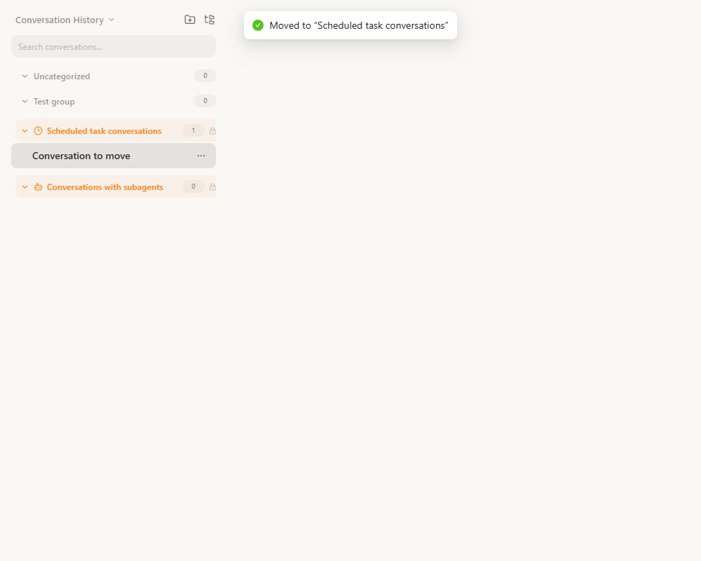
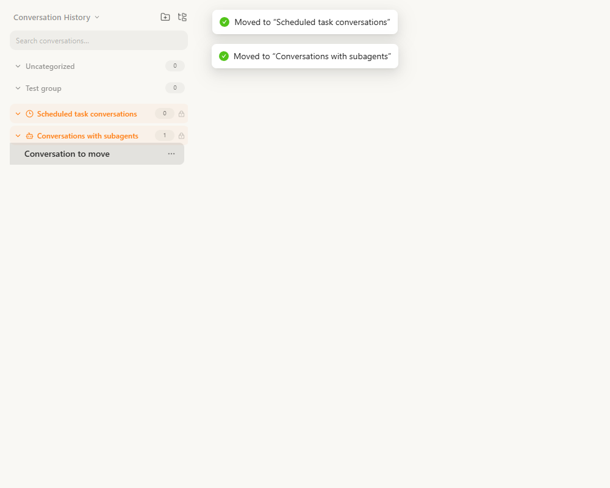
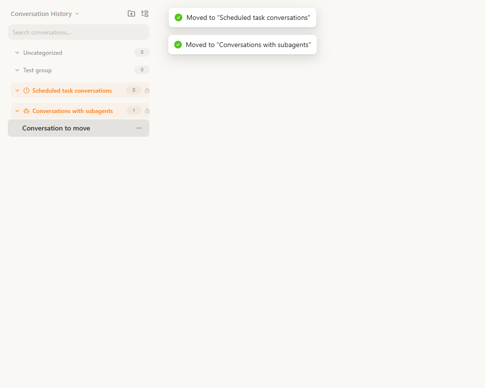
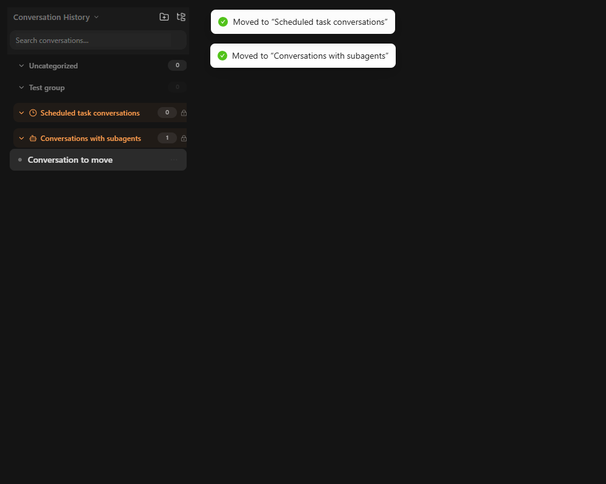

# Source-group row spacing: browser evidence

Official baseline: `7cb6234f25798ee8fe1554206942ad87b65fe73d` (main, 2026-10-19).
Fix branch: `AGImentu:codex/fix-source-group-row-height`.

The fixture imports the real `SidebarSessionList`, group headers, conversation items,
virtual list and drag-and-drop components from the source checkout. Only the HTTP
API responses are mocked. All conversation names and identifiers are synthetic.
No model calls or real conversation changes are made.

## Reproduction

1. Copy `sidebar-groups.html`, `sidebar-groups.tsx` and `sidebar-groups-check.js`
   into `console/output/playwright/` in the source checkout.
2. Run `cd console && npm ci`, then `npm run dev -- --host 127.0.0.1 --port 5181 --strictPort`.
3. Open an isolated Playwright CLI browser and run `sidebar-groups-check.js` with
   `run-code --filename=...`. Update the absolute screenshot destination to the
   local checkout before running it.
4. The runner long-presses a real conversation, moves it to the scheduled-task
   group, then to the subagent group, expands each target and hovers the item.
   It also verifies that cancelling a later drag does not change membership,
   ordinary headers remain 36px tall, and captures the dark theme.

On the baseline, disable the new gap assertion to collect measurements; on the
fix branch the runner asserts a gap of at least 2px and matching row / CSS heights.

| Measurement | Original main | Fixed |
| --- | --- | --- |
| Source header virtual row | 36px | 42px |
| Actual header plus margins | 42px | 42px |
| Conversation top minus header bottom | -4px (overlap) | 2px (clear gap) |
| Ordinary group virtual row | 36px | 36px |

Both source groups show the same before / after result. The move requests remain
`PUT /api/chats/{id}` with the intended `group_id`. The cancelled drag sends no
additional request. There are no browser runtime errors.

## Screenshots

| Group | Before | After |
| --- | --- | --- |
| Scheduled tasks |  |  |
| Subagents |  |  |

Raw measurements are in `before-measurements.json` and `after-measurements.json`.

## Automated verification

- Before applying the fix: the two added regression cases fail, 29 existing
  sidebar tests pass. Both failures report `expected 36 to be 42`.
- After applying the fix: full frontend coverage suite, 498 files / 5238 tests
  pass; coverage thresholds pass.
- `npm run format`: passes.
- `npm run build`: passes, including TypeScript, Vite, Monaco CSS, asset
  precompression and initial-bundle checks.

These fixture files and screenshots live on a separate evidence branch and are
not included in the production PR diff.
